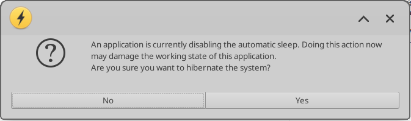

# TODO

- [x] **Ugly system dialogs.** The system dialogs (e.g. xfce4-power-manager's confirmation windows such as "hibernate?") show up as plain grey, unthemed GTK windows and look very ugly. Add a desktop module that sets a consistent GTK theme, icons and font.

  Done: `desktop/theme` (Yaru + Noto Sans, light/dark by time of day), `easylinux --theme`.

  
